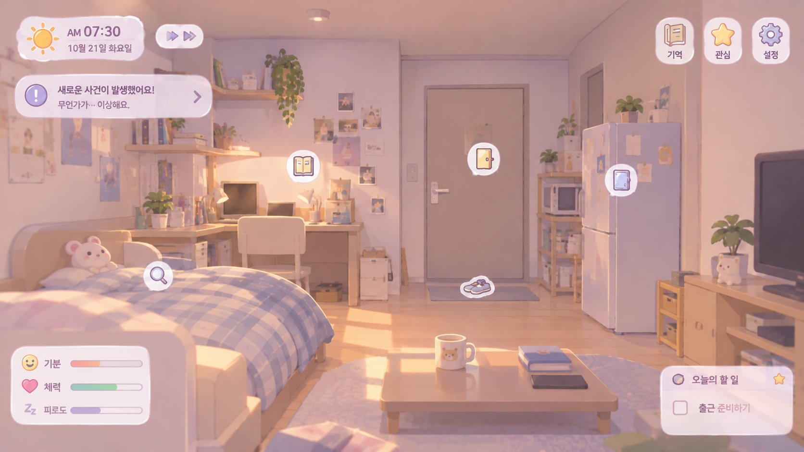

# 게임화 방향 — 엔진 준비 상태, 화면 기술, 시점, 그림, 장르, 재사용

작성일 2026-11-10 · 상태: **제안** (작가 확인 대기는 11장) · 근거: `화면-계약.md`, `구현-계획.md` S5~S7, `결정-기록.md` 1장 "플랫폼", `한계-등록부.md`

엔진을 게임 화면에 옮기기 전에 작가와 나눈 논의(2026-11-09~10)를 한곳에 모았다. **결정이 아니다.** 정해지면 `결정-기록.md`로 옮긴다.

---

## 1. 요약

- 엔진은 **계산이 단단하지만, 게임에 꽂을 손잡이가 아직 없다.** 미리 적은 각본을 처음부터 끝까지 돌리는 시뮬레이터에 가깝다.
- 다음 할 일은 **엔진 입구**(진행하기 · 입력 넣기 · 화면 정보 꺼내기 · 저장·불러오기)다. 화면을 무엇으로 만들든 같다.
- 화면 기술은 **Godot를 유력하게 검토**한다. 단 TS 코어를 다시 짜지 않고, Godot는 그리는 쪽만 맡는다.
- 시점은 **방 전체 ↔ 하루씨 곁을 오간다.** 사다리 칸마다 카메라가 한 걸음씩 다가간다.
- 그림은 **2.5D(거의 2D)**다. 여러 겹의 그림, 바꿔 끼우는 물건 그림, 필요할 때 스티커 깊이감을 쓰고, 동작은 **자세 6개**로 덮는다.
- 장르는 **요정이 곁에서 지켜보는 코지 생활 시뮬레이션 + 줄글**이다.
- 엔진은 다른 곳에도 쓸 만하다. 다만 **지금 일부러 범용화하지 않는다.**

## 2. 엔진 준비 상태 (2026-11-10 측정)

| 항목 | 값 | 확인 방법 |
|---|---|---|
| 코어 | 54개 파일, 12,056줄 | `wc -l src/core/*.ts` |
| 시험 | 517개 통과 | `npm test` |
| 시나리오 | 7개 모두 감사 위반 0 | `audit` |
| 일주일 시나리오 실행 | 약 0.7초 | `time node src/node/cli.ts day content/scenarios/first-week.json` |
| 한계 등록부 | 43건 중 열림 28건 (대부분 "기능 부재") | `data/limitations.json` |

**단단한 것**
- 같은 입력이면 같은 결과가 나온다.
- 모든 사건에 원인이 남아 "왜 그랬나"를 끝까지 따라갈 수 있다.
- 감사가 엔진의 계산을 다시 해서 맞춰 본다.

**덜 된 것**

| # | 무엇 | 게임에 왜 필요한가 | 언제 |
|---|---|---|---|
| 1 | 실시간 입구가 없다. 요정의 조언도 시나리오에 미리 적은 입력이다 | "30분 진행 → 플레이어 입력 → 계속"이 게임의 기본 고리다 | **지금** |
| 2 | 앵커를 눌러도 아무 일이 없다 (LIM043) | 줄글 속 말을 눌러 주의를 돌리는 것이 개입 수단이다 | **지금** |
| 3 | 중간 저장이 완전하지 않다 (LIM029 숙련 횟수 등). 하루 중간에 껐다 켜기는 시험하지 않았다 | 휴대폰 게임은 아무 때나 꺼진다 | **지금** |
| 4 | 수치 대부분이 임시값(`tuned:false`)이다 (컨디션·모드·긴박함·감별 문턱) | 플레이해 봐야 맞출 수 있다 | 화면이 생긴 뒤 |
| 5 | 내용이 작다: 인물 1, 방은 사실상 부엌 1, 이벤트 1(냉장고 냄새), 감각은 냄새 위주 | 판이 한 바퀴 돌아야 무엇이 더 필요한지 보인다 | 나중 |
| 6 | 열린 한계 28건 | 고장이 아니라 아직 없는 기능 | 나중 |

**순서 (제안)**: 엔진 입구(1~3) → 부엌 한 칸을 회색 상자 화면으로 → 직접 해 보며 숫자 맞추기(4) → 방·감각·이벤트 늘리기(5·6).

## 3. 화면 기술: 브라우저 또는 Godot

작가 제안 (2026-11-09): 브라우저로 만들면 문제가 커질 것 같으니 Godot로 만들면 어떤가.

**원칙**: TS 코어를 GDScript·C#으로 다시 짜지 않는다. 코어는 1만 줄이 넘고 감사·영수증·시험 500여 개·관문·가드가 모두 TypeScript에 묶여 있다. 다시 짜면 두 벌을 맞추는 동안 "감사를 통과한 하루"라는 안전장치를 잃는다.

| 길 | 방법 | 장단점 |
|---|---|---|
| A (권함) | Godot 웹 내보내기 + `JavaScriptBridge`로 브라우저 안의 TS 코어를 부른다 | 코어 그대로. 배포가 웹이라 "가벼운 웹"(확정)과도 맞는다. 웹 내보내기에서만 된다 |
| B | 데스크톱·모바일. 코어를 별도 프로세스(Node)로 띄워 JSON으로 주고받는다 | 데스크톱은 되지만 Node를 같이 묶어야 하고 모바일은 어렵다 |
| C | 게임이 굳은 뒤 시험을 기준으로 코어를 C#으로 한 층씩 옮긴다 | 가장 자유롭지만 가장 비싸다. 지금 할 일이 아니다 |

- Godot 안에 JS 엔진을 넣는 커뮤니티 확장은 성숙도를 확인하지 못해 기본 길로 두지 않는다.
- 그림이 거의 2D로 정해지면서(6장) 브라우저와 Godot의 차이는 줄었다. 그래도 그림 배치·확대·이동·입자 효과를 편집기에서 눈으로 맞출 수 있어 Godot가 편하다.
- **어느 길이든 먼저 할 일은 같다**: 코어와 화면 사이의 좁은 문. 들어가는 것은 저장 상태와 플레이어 입력, 나오는 것은 사건 기록과 화면 계약 JSON이다. 화면 계약(`화면-계약.md`, `src/core/viewmodel.ts`)은 이미 있다.
- **결정 기록과의 관계**: 플랫폼 "가벼운 웹"은 확정이다. A는 웹 그대로다. B·C로 가면 결정 기록을 바꿔야 한다.

## 4. 화면 시안 검토

작가가 만든 시안 (2026-11-09). 줄글이 나오는 곳은 빼고 그렸다.

**그대로 맞는 것**
- **시계·날짜, 빨리 감기**: 엔진의 시계와 "진행하기" 입구.
- **오늘의 할 일**: 하루 일정(routine)의 다음 블록.
- **기억 버튼**: 엔진의 기억.
- **물건 위 아이콘**: 화면 계약의 주의 돌리기(`attend`) 대상.
- **원룸 구조**: "방은 부엌 하나"로 묶어 둔 지금과 맞는다. 방 옮기기(LIM016)를 미뤄도 어색하지 않다. 단 엔진에는 지금 현관(PLC000001)과 주방(PLC000002)이 따로 있다.

**바꾸면 좋은 것**
1. **"새로운 사건이 발생했어요!" 알림**: 게임이 먼저 사건이라고 알려 주면 심상 사다리의 천천히 알아차리는 맛이 사라진다. 그 자리에 장면 문장(사다리의 첫 칸)을 띄운다.
2. **기분·체력·피로도 막대**: 엔진에 있는 것은 감정(세 축)과 컨디션(여유·에너지·긴장)이고 값은 단계다. 체력과 피로도는 둘 다 에너지라 겹친다.
3. **하루씨가 화면에 없다**: 하루씨가 어디서 무엇을 하는지 보여야 한다.
4. **누르는 주체**: 하루씨는 스스로 움직이고 플레이어는 요정이다. 아이콘을 누르면 하루씨가 바로 움직이는 것이 아니라 "요정이 가리킨다".
5. **냄새를 눈으로**: 사다리 칸에 따라 아지랑이 같은 표현이 냉장고 쪽으로 좁혀진다.

**줄글 자리**: 아래 가운데(탁자 부근).

## 5. 시점: 두 시점을 오간다

작가: 하루 어깨에 떠다니며 볼지, 하루 옆모습을 볼지 고민 → 두 시야를 오가는 쪽.

| | 방 전체 | 어깨 위 요정 |
|---|---|---|
| 느낌 | 아늑한 미니어처 방, 하루를 지켜봄 | 하루와 같이 있음, 요정 역할이 산다 |
| 잘 맞는 것 | 일정·쉼·출근 같은 하루의 흐름 | 심상 사다리 (하루의 시선 = 화면) |
| 약점 | 요정이 화면 밖처럼 느껴진다 | 방 전체·표정이 안 보이고 휴대폰에서 어지러울 수 있다 |

**사다리 칸 → 카메라 (제안)**

| 때 | 화면 |
|---|---|
| 평소 | 방 전체. 하루는 방 안에 작게, 요정은 어깨 근처의 작은 빛 |
| 느낌 | 하루 옆모습으로 살짝 다가간다 (고개를 드는 표정) |
| 짐작 · 좁힘 | 어깨 너머로, 하루가 보는 쪽(냉장고)을 함께 본다 |
| 정체 | 그 물건을 가까이 |
| 이벤트가 닫힘 | 다시 방 전체 |

- 엔진은 장면을 고를 때 이미 사다리 칸을 안다. 화면 계약에 **"칸 → 카메라" 표를 데이터로** 더하면 된다 (코드에 박지 않는다).
- 정하기 전에 회색 상자 방에서 두 시점을 휴대폰으로 직접 움직여 본다.

## 6. 그림 방식: 2.5D (거의 2D)

작가: 3D가 아니라 약간 2.5D, 거의 2D 느낌. 처음 구상은 스티커를 붙여 깊이감을 만드는 것이었다. 지금 필요한지는 고민 중이다.

- **방은 그림 여러 겹**: 뒤 벽, 가구, 앞 소품(탁자·이불)을 따로 그려 겹친다. 카메라가 움직이면 겹마다 다르게 움직여 깊이가 생긴다.
- **다가가는 시점**:
  - 느낌·짐작은 같은 그림을 확대하고 옮긴다.
  - 좁힘·정체는 클로즈업 그림을 따로 둔다 (하루 옆얼굴, 어깨 너머 냉장고. 비주얼노벨의 이벤트 그림처럼).
- **물건 상태는 그림을 바꿔 끼운다**: 냉장고 닫힘/열림, 창 닫힘/열림.
- **김·냄새·햇빛은 그리지 않는다**: 입자 효과와 반투명 빛 층으로 만든다. 아침·저녁·밤은 색 덧칠로 바꾼다 (엔진의 `dayPartOf`).
- **스티커 깊이감**: 흰 테두리와 살짝 뜬 그림자만으로 앞뒤가 갈리고, 공을 덜 들여도 깊이가 생긴다. 상태가 바뀔 때 스티커를 바꿔 붙이는 느낌이 엔진의 상태 변화와 맞는다. 시안의 아이콘도 이미 스티커 모양이다.
  - **지금 정하지 않아도 된다.** 물건마다 따로 된 그림이고 위치는 데이터에서 읽으므로, 테두리 스티커든 칠한 그림이든 회색 상자든 바꿔 끼우는 일이다. 깊이를 얼마나 줄지(겹 수·그림자·카메라 움직임)는 화면의 숫자 몇 개다.
  - 돌아가는 판을 직접 해 본 뒤 정한다.

**부엌 원룸 한 판에 필요한 그림 (어림)**

| 무엇 | 장수 |
|---|---|
| 방 배경 (겹으로 나눔) | 1벌 |
| 물건 상태 (냉장고·창·현관문·냄비·그릇 등) | 10장 안팎 |
| 하루 자세 | 6장 + 걷기 |
| 클로즈업 | 옆얼굴 1~2장(여러 사건에 같이), 사건마다 물건 1~2장 |

## 7. 동작: 사람은 단순하게, 물건이 이야기한다

작가: 요리를 먹는 모습을 그릴 수는 없을 것 같다. 생각 이상으로 하이 테크놀로지 같다.

- 하루는 **자세만** 바꾸고 숨 쉬듯 살짝 움직인다. 숟가락을 입에 넣는 동작은 없다.
- 변화는 **물건이** 보여 준다: 냄비의 김, 줄어드는 찌개, 개수대로 가는 빈 그릇. 엔진이 국물 단계·남은 양·그릇 위치를 이미 계산한다.
- 느낌은 **줄글이** 맡는다.
- **장면 전환**으로 시간을 건너뛴다: 요리 시작 → 살짝 어두워짐 → 완성된 냄비.

**행동 → 자세** (사전의 행동 30개를 셈, 2026-11-10)

| 자세 | 행동 |
|---|---|
| 조리대 앞에 서기 | 썰기, 넣기, 요리하기, 데우기, 튀기기, 불 끄기, 물 담기, 설거지, 닦기 |
| 식탁에 앉기 | 먹기, 웹툰 보기, 주문하기 |
| 냉장고 앞 (문 열림) | 꺼내기, 보관, 옮겨 담기, 비우기, 살피기 |
| 눕기 | 눕기, 쉬기, 드라마 보기 |
| 창가·현관 | 환기, 장보기(나가기) |
| 쭈그려 앉기 | 버리기, 울기 |
| (미정) | 설치, 판매, 고치기, 켜기, 닫기, 옮기기 — 대부분 "서기"나 짧은 컷 |

- 여기에 걷기 하나. 걷기·앉기 같은 기본 동작은 무료 애니메이션 모음을 참고할 수 있다 (3D 인물을 쓸 경우).
- 이 표도 **사전 데이터**로 둔다.

## 8. 장르

**"요정이 곁에서 지켜보는 코지 생활 시뮬레이션"** + 줄글로 읽는 비주얼노벨의 맛.

| 섞인 것 | 이 게임에서 |
|---|---|
| 생활 시뮬레이션 | 하루가 스스로 일정대로 살고 요리하고 살핀다. 플레이어가 조종하지 않는다 |
| 돌봄·관찰 | 요정으로서 지켜보고 가끔 조언한다. 들을지는 하루의 상태가 정한다 |
| 비주얼노벨·인터랙티브 픽션 | 중요한 순간의 클로즈업 그림과 작가의 줄글, 문장 속 말 누르기 |
| 코지 게임 | 원룸, 아침 햇살, 작은 일상. 제목 "작은 행복" |

**다른 점**: **알아차림**이 놀이의 중심이다. "배고픔 30%" 대신 "뭔가 냄새가… 시큼한가? 냉장고인가?"를 함께 겪는다.

**장르가 정해 주는 것**
- 속도: 느긋하게. 빨리 감기가 기본이고 중요한 순간에 멈춘다.
- 한 번 하는 시간: 짧게, 하루 하나 정도. 휴대폰과 맞는다.
- 화면: 숫자 막대보다 문장과 표정. 상태 막대는 작게, 또는 없이.

소개 문구 후보: "하루씨의 원룸, 그 곁을 떠다니는 요정이 되어 작은 행복을 지켜보세요."

## 9. 다른 곳에 쓸 수 있나

코어에서 냄새·요리 말이 많이 나오는 파일은 `ladder.ts`(62곳), `audit.ts`(49), `vocab.ts`(44), `perception.ts`(32), `odor.ts`(32) 정도다. 시계·사건 기록·원인 잇기·세계 상태·규칙·감정·컨디션·장면 고르기·저장·패치·관문은 냄새를 몰라도 돈다. 물건·장소 이름은 코드에 없고 사전과 데이터에만 있다.

| 어디에 | 쓰는 부분 | 왜 |
|---|---|---|
| 추리·미스터리 게임 | 심상 사다리, 원인 사슬 | 느낌 → 짐작 → 좁힘 → 정체가 곧 추리다. 사건 기록이 단서가 된다. 가장 잘 맞는다 |
| 다른 생활·농사·생존 게임 | 변화 규칙(상하기·익기), 일정, 컨디션 | 음식 대신 작물·날씨를 넣는다 |
| 교육용 시뮬레이션 | 부패 사슬, 영수증 | 예: 식품 위생. "왜 상했나"를 원인 사슬로 |
| 작가용 이야기 도구 | `.ev` 줄글 문법, 장면 조건 | 프로그래머 없이 작가가 상황별 장면을 쓴다 |
| AI와 함께 개발하는 방법 | 패치·사전·관문·감사·가드 (`꼼수-방지.md`) | AI가 데이터를 함부로 바꾸지 못하게 하는 틀. 다른 프로젝트에 그대로 옮긴다 |

**걸림돌**
- 심상 사다리가 아직 냄새 전용이다. 감각(소리·시각)을 넓힐 때가 첫 재사용 시험이다.
- 감사 코드가 크다 (1,236줄). 새 시스템마다 같은 계산을 감사에도 더해야 한다.
- 사전이 한국어 중심이고, 라이브러리로 묶여 있지 않다.

**방침 (제안)**: 지금 일부러 범용화하지 않는다. 지금의 규칙(코드에 이름을 박지 않기, 코어는 입출력 없이)을 지키면 떼어 내기 쉬운 상태가 유지된다. 엔진 입구는 범용으로 짠다. 그러면 그대로 다른 게임의 입구가 된다.

## 10. 다음

1. **엔진 입구**: 진행하기 / 입력 넣기 / 화면 정보 꺼내기 / 저장·불러오기. 각본 실행도 이 입구를 거치게 바꿔, 지금의 시험이 입구를 검증하게 한다. 앵커(LIM043)와 중간 저장(LIM029)도 함께.
2. 회색 상자 방: 시간 흐름 · 냄새 사건 · 장면 줄글 · 요정의 가리키기가 한 바퀴 돈다. 두 시점을 시험한다.
3. 직접 해 보며 임시값을 맞추고, 그림 방식(스티커 깊이 포함)을 정한다.

## 11. 작가 확인 대기

| # | 묻는 것 | 선택지 |
|---|---|---|
| 1 | 화면 기술 | Godot 웹 내보내기(A) / 데스크톱·모바일(B) / 브라우저 직접 |
| 2 | 브라우저가 "문제가 커질 것"이라 본 이유 | 연출 / 스토어 배포 / 화면 코드 복잡도 |
| 3 | 집 구조 | 원룸 하나 / 지금처럼 현관과 부엌을 나눔 |
| 4 | 상태 막대 | 컨디션 셋 그대로 / 일부 / 막대 없이 문장으로 |
| 5 | 그림을 그리는 사람과 도구 | 직접 그림 / 다른 사람 / 미정 |
| 6 | 스티커 깊이감 | 회색 상자 판을 해 본 뒤 |
| 7 | 장르의 무게 | 생활 시뮬 / 이야기 읽기 / 돌봄 |
