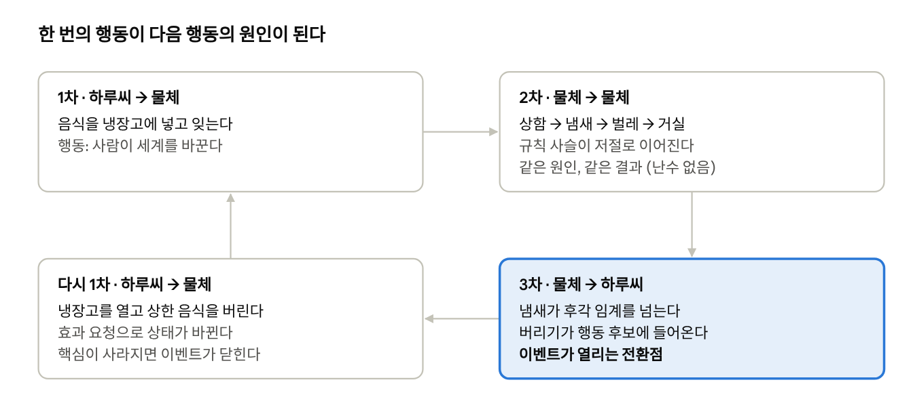
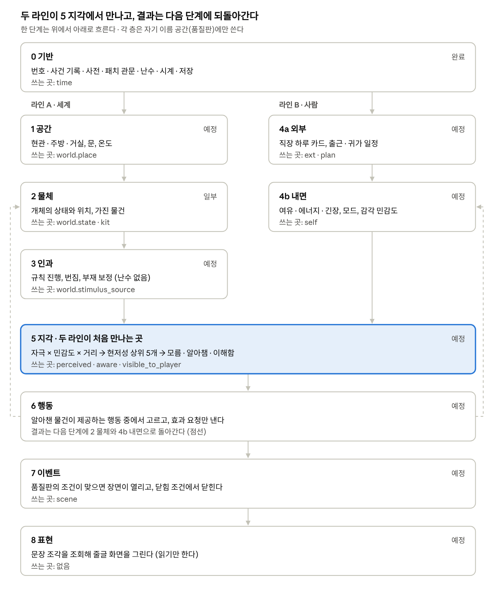
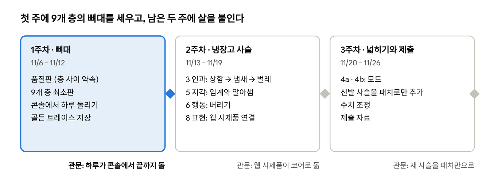

# 당신의 하루가 소박한 행복이 되기를 — 기획서

작성일 2026-11-06 · 상태: **초안** · 근거: `기획보고서-v3.md`, `축과-층위.md` 3장, `품질판-명세.md`, `상호작용-명세.md`, `축-상호작용-설계.md`, `감정-모델-초안.md`, `결정-기록.md`

처음 보는 사람이 게임과 엔진 전체를 한 문서로 이해하도록 모은 기획서다. 세부 규칙과 결정은 근거 문서에 있고, 결정의 원본은 `결정-기록.md`다. 공유용 원본은 Claude Docs 문서이며 이 파일은 그 사본이다.

혼자 사는 직장인 하루씨의 하루를 곁에서 지켜보며 돕는 생활 시뮬레이션이다. 사건을 미리 쓰지 않고, 집과 사람의 상태가 서로 맞물려 이야기를 만든다.

## 1. 한눈에

**하루가 무너진 하루씨의 하루하루가 다시 쌓여서 온전한 행복이 되기를.** 집을 돌보는 과정에서 그곳에 머무는 자신도 함께 돌보게 된다는 것이 이 게임의 메시지다.

| 항목 | 내용 |
| --- | --- |
| 장르 | 스토리텔링 기반 생활 시뮬레이션 (웹) |
| 주인공 | 하루씨. 혼자 사는 직장인, 18평 복도식 집 |
| 플레이어 | 직접 조종하지 않고 곁에서 지켜보며 돕는 사람 |
| 대상 | 스토리 게임을 좋아하는 일반 사용자. 생활이 버거운 사람도 할 수 있게 실패를 비난하지 않는다 |
| 핵심 원칙 | **콘텐츠는 시스템에서 나온다.** 시스템이 사실을 만들고, 작가는 그 순간의 문장을 쓴다 |
| 첫 범위 | 현관 + 냉장고(주방), 인물 1명 |
| 제출 | 3주 안에 시제품. 창업대회, AI 활용 수업 프로그램 대회, 대학 과제 |

목표는 네 가지다.

1. 일상의 활동 사이에 있는 **인과관계**를 경험하게 한다.
2. 보이는 것이 늘어나는 것, 곧 **시야의 확장**을 성장으로 만든다.
3. 한 사람과 오래 함께하는 **지켜보는 맛**을 만든다.
4. **작가 한 사람이 감당할 수 있는 분량**으로 풍부한 사건을 만든다.

## 2. 플레이 경험

하루씨는 스스로 산다. 플레이어는 하루씨를 움직이지 않고, 하루씨가 더 잘 알아채고 더 쉽게 해낼 수 있게 곁에서 돕는다.

**플레이어의 손은 세 가지다.**

- **공간과 물품**: 물건을 놓아 주면 하루씨가 알아채고 쓴다.
- **주의 돌리기**: 줄글에서 단어를 누르면 하루씨의 주의가 그쪽으로 간다.
- **지켜보기**: 누르지 않으면 하루씨의 습관과 그날의 모드가 알아서 한다.

**화면은 하루씨가 느끼는 하루를 적은 줄글이다.**

> 현관을 열자 **꼬릿한 냄새?** 가 났다.
> → (누름) 킁킁. **어디지.** 근데 은근 구수하네.
> → (누름) 주위를 둘러본다 …

- 눌리는 단어는 하루씨가 **알아챈 것**이다. 링크는 손으로 엮지 않고, 아직 모르는 정보(위치, 정체)에서 자동으로 생긴다.
- "근데 은근 구수하네" 같은 반응은 인물의 **감각 프로파일**에서 나온다. 같은 냄새에도 사람마다 반응이 다르다.
- 단어를 눌러 **회상**을 물을 수도 있다. 모든 답은 지각·회상·지식·감정·계획 다섯 출처에서만 나오고, 정보가 없으면 "기억이 안 난다"처럼 정해 둔 기본 응답을 한다.

**하루와 주의 구조**

| 단위 | 내용 |
| --- | --- |
| 밖의 하루 | 직장은 요약 카드로 정해지고, 귀가할 때 컨디션에 반영된다. 현관은 밖이 안으로 들어오는 문턱이다 |
| 하루 | 실제 다음 날 새벽 4시 이후에 열린다. 며칠 비워도 불이익이 없고, 돌아오면 현관을 여는 귀환 장면으로 시작한다 |
| 주 | 7일. 끝나면 상태를 이어 가며 1일차로 돌아간다. 인지·습관·소유물은 이어지고 오염은 주간 정산에서 한 단계 완충된다 |
| 정산 | 하루가 끝나면 정산 산문이 나온다. 그 안의 단어도 눌러서 회상할 수 있다 |

**설계 원칙**: 못 한 일은 실패가 아니라 상황이다. 큰 결과 전에는 반드시 증상이 먼저 나타난다. 숫자 계기판으로 몰아붙이지 않는다. 물건은 지워지지 않고 보관으로 옮겨진다.

## 3. 콘텐츠는 시스템에서 나온다

사건은 미리 쓰지 않는다. 사람과 물건의 상호작용이 다음 상호작용을 부르는 **고리**에서 이야기가 나온다.

고리가 닫히므로 한 번의 사건이 다음 사건의 원인이 된다. 사람이 "상함 → 벌레 → 거실"을 직접 이은 곳은 없다. 규칙의 조건과 결과가 맞아서 저절로 이어진 것이다.

작가가 쓰는 것은 **이벤트가 열리는 조건, 그 순간의 문장, 선택지**뿐이다. 내용이 늘어도 분기 트리를 손으로 엮지 않으므로, 작가 한 사람이 감당할 수 있다.

## 4. 엔진 구조

엔진은 **9개 층**이다. 층은 아래 층의 결과만 읽고, 층 사이의 약속은 **품질판**(이름 붙은 값들의 판) 하나뿐이다. 층이 안에서 어떻게 계산하는지는 위 층이 모른다.

세계(라인 A)와 사람(라인 B)은 서로 읽지 않고, 하루씨가 무언가를 **지각하는 순간 처음 만난다.** 집이 더러워도 하루씨가 알아채지 않으면 마음은 흔들리지 않는다.

- **쓰기**: 한 이름 공간은 한 층만 쓴다. 다른 층이 바꾸고 싶으면 효과 요청을 낸다.
- **되먹임**: 위에서 아래로 가는 길은 네 가지뿐이고 모두 다음 단계에 반영된다. 행동 → 물체(치우기), 행동 → 내면(해냈다, 피곤하다), 지각 → 내면(알아챈 것의 정서), 기억 → 내면(어제의 집 인상).
- **난수의 자리**: 0~3층과 4b층에는 난수가 없다. 외부 카드, 판정 경계, 행동 판정, 장면 선택, 문장 변주에만 쓰고, 뽑은 결과는 저장해 다시 돌려도 같게 한다.
- **늘어나도 바뀌지 않는다**: 새 요소는 중립값(곱 1)으로 들어와 켜기 전까지 아무것도 바꾸지 않는다. 조건은 단계 번호가 아니라 이름(`smell@>=distinct`)으로 건다. 그래서 층이나 축이 늘어도 기존 이벤트가 깨지지 않는다.

## 5. 상호작용의 형태

엔진이 아는 상호작용은 **다섯 가지 결합뿐**이다. 잔류·손상·자국 같은 현상은 따로 만들지 않고 이 조합으로 나오게 한다.

| 결합 | 방향 | 뜻 | 예 |
| --- | --- | --- | --- |
| 접촉 전달 | 물체 ↔ 물체 | 면이 닿으면 양이 옮겨진다. 만들어지지 않고 옮겨질 뿐이다(보존) | 밑창 먼지가 현관 바닥으로 |
| 규칙 사슬 | 물체 ↔ 물체 | 조건(`on`)이 맞으면 결과(`emits`) 상태가 생긴다 | 상함 → 냄새 |
| 누적 | 시간 ↔ 물체 | 노출이 쌓여 임계에서 단계가 오른다 | 신선 → 시듦 → 상함 |
| 지각 | 물체 → 인물 | 상태가 감각 임계를 넘으면 하루씨에게 보인다 | 주방의 냄새를 맡는다 |
| 행동 | 인물 → 물체 | 하루씨의 동사가 상태를 바꾼다 | 상한 음식을 버린다 |

**한 번의 상호작용 = 누가, 무엇에, 어디서, 무엇을 써서, 무엇을 했나 → 상태가 어떻게 바뀌었나.** 행위자, 동사, 대상, 장소, 도구, 맥락(시간대, 모드), 결과를 적는다.

**꼭 지키는 세 가지 약속**

1. **효과 요청**: 상태는 주인 층만 바꾼다. 행동이나 이벤트는 결과를 직접 정하지 않고 "이렇게 바꿔 달라"고 요청한다.
2. **모든 변화는 사건으로 남는다**: 행동 완료, 접촉, 상태 변화가 원인(`cause`)으로 이어져 "왜 이렇게 됐는가"를 끝까지 따라갈 수 있다.
3. **인과에는 난수가 없다**: 같은 원인이면 같은 결과가 나와야 플레이어가 배울 수 있다. 난수는 이벤트 발생과 행동 판정에만 쓴다.

**시간과 판정** (작가 승인)

- **이벤트 기반 시간**: 매 틱을 돌리지 않고 다음 변화 시각을 예약한다.
- **지연**: 원인이 성립하면 예약이 생기고, 발화 시점에 조건을 다시 본다. 그 사이 치웠으면 취소된다.
- **동시 갱신**: 한 경계에서 모든 규칙이 직전 값을 읽고 한꺼번에 쓴다.
- **저항**: 오래 방치할수록 행동 비용이 커진다 (물티슈 한 장 → 세제와 3분).
- **물건이 행동을 제공한다**: 물건이 자기가 줄 수 있는 행동(동사·전제·효과·해소하는 욕구·비용)을 가지고, 하루씨는 알아챈 물건의 행동만 고른다. 새 물건을 넣어도 인물 쪽 코드는 그대로다.

## 6. 이벤트

이벤트는 미리 쓴 분기가 아니라, 상호작용 고리의 **전환점을 포착한 것**이다. 인지가 오른 순간, 모드에 들어간 순간, 단계가 오른 순간이 그런 자리다. 작가는 포착 조건, 장면(문장 조각), 선택지만 쓰고 분기를 엮지 않는다.

**세 성질**

| 성질 | 뜻 | 검사 |
| --- | --- | --- |
| 열려 있다 | 여러 감각 경로로 열린다. 경로가 달라도 핵심이 같으면 같은 이벤트다 | 진입 경로마다 첫 장면이 있다 |
| 연쇄적이다 | 처리 방식과 방치가 다음 이벤트로 이어진다 | 후속 이벤트가 실제로 있다 |
| 닫힌다 | 끝없이 떠다니지 않고 닫히는 조건이 있다 | 닫힘 조건이 없으면 관문이 거부한다 |

**핵심과 주변부**: 핵심은 원천(상한 음식)이고, 주변부는 그에서 파생된 것(냄새, 벌레)이다. 주변부는 알아채기만 해도 싸고 빠르게 처리할 수 있지만(환기) 임시다. 핵심은 정체와 위치를 알아야 처리할 수 있고, 처리하면 닫힌다.

| 상황 | 결과 |
| --- | --- |
| 핵심을 처리하고 주변부가 임계 아래로 | 닫힘 |
| 주변부만 처리 | 잠시 눌렸다가 다시 열림 |
| 방치 | 번져서 후속 이벤트로 이어짐 (주방 → 거실) |

**수동적 드러남과 능동적 발견** (논의 중, 2026-11-06)

이벤트는 저절로 열리기만 하는 것이 아니다. 임계에 닿기 전에 **먼저 찾아낼 수도** 있다.

| | 수동 (드러남) | 능동 (찾아냄) |
| --- | --- | --- |
| 계기 | 상태가 임계를 넘어 저절로 감각에 걸린다 | 하루씨나 플레이어가 먼저 살핀다 (냉장고 열기) |
| 시점 | 늦다. 냄새가 이미 퍼진 뒤 | 이르다. 임계 아래에서도 찾는다 |
| 처리 | 무겁고 비싸다 (저항이 크고 주변부까지 번짐) | 가볍고 싸다 |
| 인지 | "뭔가 있다"만 안다 | 살피는 행동이 정체와 위치를 알려 준다 |

- 같은 이벤트 하나에 **들어가는 길이 둘**이다. "경로가 달라도 핵심이 같으면 같은 이벤트"라는 원칙에 그대로 들어간다.
- 일찍 찾는 능력이 늘어나는 것이 곧 "시야의 확장"이라는 성장이다.
- 미정: 임계가 둘(발견 가능 임계 < 드러남 임계)인지, 하나이고 살피면 낮아지는지. 능동 발견의 주체(하루씨의 습관, 플레이어의 주의 돌리기, 둘 다).

## 7. 인물의 내면

내면은 이론에서 시작하지 않고 **화면에서 보여야 할 행동(출력)에서 거꾸로 짠다.** 보이지 않는 변수는 비용만 들기 때문이다.

**짜는 순서**

1. **출력 목록**: 하루씨에게서 보고 싶은 장면을 15~20개 적는다 (작가).
2. **차이 찾기**: "같은 집, 같은 냄새인데 왜 오늘은 다르게 행동하나?"를 묻는다.
3. **압축**: 여러 출력을 함께 설명하는 최소한의 변수만 남긴다. 출력마다 변수를 하나씩 만들면 하드코딩과 같아지므로 피한다.
4. **시험으로 고정**: "피곤한 날 100번을 돌리면 냉장고를 여는 비율이 꼼꼼한 날보다 낮다"처럼 출력을 시험으로 바꾼다.

**예: "하루씨가 냉장고를 먼저 열어 보는가?"**

| 보고 싶은 장면 | 필요한 내면 | 상태 |
| --- | --- | --- |
| 여유 있는 날은 열어 본다 | 여유·에너지 | 설계됨 |
| 원래 자주 확인하는 사람이다 | 습관 | 설계됨 |
| 매일 맡다 보니 냄새를 못 느낀다 | 익숙해짐 | 초안 |
| 냄새를 알면서도 안 연다. 열면 싫은 걸 볼 것 같아서 | 예상되는 불쾌를 피하는 경향 | 새로 필요 |

**지금 있는 설계 (초안)**

- **컨디션**: 여유·에너지·긴장. 여유는 평균이 0이고, 쌓임 → 임계 → 방출의 리듬으로 "갑자기"를 난수 없이 만든다. 숫자 계기판으로는 보이지 않는다.
- **모드**: 방전(아무것도 못 하는 날), 터짐(펑펑 우는 날), 몰아침(두 시간 청소), 평온.
- **감정**: 쾌·불쾌는 두 축이라 "후련한데 피곤한" 상태가 가능하다. 안정은 예측과 실제의 차이가 작은 상태다. 불쾌가 풀린다고 쾌를 주지 않는다 (방치를 보상하지 않기 위해).
- **감각 프로파일**: 감각 5종의 민감도와 취향. 같은 시스템에서 다른 인물이 나온다.
- **자율 행동**: 욕구·습관·취향·비용으로 점수를 매기고, 알아챈 물건의 행동만 후보가 된다.
- **인지와 기억**: 모름 → 알아챔 → 이해함. 기록은 진실이고 기억은 하루씨가 겪은 것의 주관적 부분집합이다.
- **집은 내면을 직접 깎지 않는다**: 하루씨가 알아챈 것과 해낸 것을 거쳐서만 마음에 닿는다.

## 8. 데이터와 품질 관리

게임의 모든 사실은 코드가 아니라 **데이터**에 있고, 데이터는 **관문을 통과한 패치로만** 들어간다. 작가 한 사람이 콘텐츠를 계속 늘려도 서로 어긋나지 않게 하는 바탕이다.

| 장치 | 하는 일 |
| --- | --- |
| 정의 저장소 | 오브젝트·장소 같은 정의가 자기 부위(상태 자리), 규칙, 제공 행동을 가진다. 연결은 뜻 없는 고정 번호로만 건다 |
| 사전 (통제 어휘) | 게임이 쓰는 모든 단어는 사전에 있어야 한다. "오염", "때" 같은 별칭은 공식 키 `dirt`로 바뀐다. 단계는 사다리 6칸이고 키로 부른다 (`smell@>=distinct`) |
| 패치 관문 | 오류가 하나라도 있으면 패치 통째로 거부한다. 패치마다 이유(`why`)가 필수다 |
| 사슬 자동 연결 | 규칙의 결과와 다른 규칙의 조건이 맞으면 사람이 잇지 않아도 이어진다. 예시 패치에서 상함 → 냄새 → 벌레 → 거실 번짐이 자동으로 이어졌다 |
| 패치 보고서 | 넣기 전에 범위·영향·새로 이어진 사슬·검증 결과를 보여 준다 |

**AI와 함께 만드는 프로젝트라서**, AI가 일을 쉽게 끝내려고 쓰는 얕은 수를 구조로 막는다.

| 장치 | 막는 것 |
| --- | --- |
| 거부 사례 모음 + 바닥값 | 통과시키려고 관문을 느슨하게 하기. 잘못된 패치 19건이 계속 거부되어야 하고, 건수는 줄일 수 없다 |
| 금지 패턴 검사 | 시험 끄기, 타입 오류 숨기기, 코어에서 현재 시각·난수 직접 쓰기 |
| 재생 검사 | 데이터 파일을 손으로 고치기. 기록된 패치를 처음부터 다시 적용해 바이트까지 비교한다 |
| 가드 | 규칙을 이유 없이 바꾸기. 관문·사전·시험을 바꾸면 같은 커밋에서 결정 기록을 고쳐야 한다 |
| CI | "내 환경에서는 통과했다"는 주장. 서버에서 모든 검사를 다시 돌린다 |

막지 못하는 것은 숨기지 않고 문서에 적는다. 결정은 항목마다 확정·기본안·미정으로 나눠 `결정-기록.md` 한 곳에 모은다.

## 9. 차별점

재료 하나하나는 흔하지만, **이것들을 하나로 묶은 조합은 드물다.** 2026-11-03 웹 검색에서는 "어질러짐이 시간에 따라 번지고 인물이 자율로 사는" 조합을 찾지 못했다 (없다고 단정하지는 않는다, `선행-사례.md`).

| 비교 대상 | 닮은 점 | 다른 점 |
| --- | --- | --- |
| Neat, Cozy Cleaner 등 정리·청소 게임 | 정리와 이야기, 압박 없는 루프 | 정해진 어지러움을 치울 뿐, 집이 혼자 변하지 않는다 |
| 심즈 | 욕구로 행동을 고르고, 물건이 자기 쓰임을 알린다 | 플레이어가 조종한다. 이 게임은 조종하지 않고 돕는다 |
| 림월드, 드워프 포트리스 | 시스템에서 이야기가 나온다. 기분과 무너짐 임계 | 생존·경영 중심. 이 게임은 한 사람의 일상과 마음 |
| 인터랙티브 픽션 (storylet) | 조건이 맞으면 열리는 이야기 조각 | 미리 쓴 상태값. 이 게임은 시뮬레이션이 상태를 만든다 |

**이 게임만의 것**

1. **집이 혼자 변한다.** 상함 → 냄새 → 벌레 → 거실로 번지는 인과가 접속하지 않은 날에도 진행된다.
2. **화면이 줄글이다.** 시뮬레이션 결과를 하루씨가 느끼는 문장으로 보여 주고, 단어를 눌러 주의를 돌린다.
3. **모르다가 알아채는 과정이 게임이다.** "뭔가 냄새가 난다 → 음식인가 → 냉장고 우유다"처럼 감각으로 앎이 좁혀진다.
4. **플레이어는 돕기만 한다.** 일찍 찾아내도록 주의를 돌려 주는 것이 플레이어의 몫이다.
5. **주제가 시스템으로 표현된다.** "집을 돌보며 나를 돌본다"를 대사가 아니라 인과로 보여 준다.

## 10. 현재 상태와 3주 일정

지금은 **0층(기반)이 완료되고 2층(물체)이 일부** 만들어진 상태다. 시험 184개가 모두 통과한다 (2026-11-06).

| 항목 | 상태 |
| --- | --- |
| 기반: 번호, 사건 기록, 사전, 정의 저장소·패치 관문, 난수, 시계, 저장 | 완료 |
| 꼼수 방지 구조, CI | 완료 |
| 세계 상태: 상태는 사건으로만 바뀌고, 기록에서 같은 상태를 다시 만든다 | 완료 (양 저장은 미룸) |
| 화면 계약: 코어가 내고 화면이 그리는 뷰 모델, 냉장고 냄새 장면 6개 | 완료 |
| 웹 시제품 (현관 장면) | 거친 판, 코어와 연결 안 됨 |
| 게임 데이터 (집, 물건, 인물) | 0개. 예시 패치만 있음 |
| 1, 3~8층 | 시작 전 |

**방침: 뼈대 먼저, 살은 나중에.** 층 하나를 완성하고 다음으로 넘어가지 않는다. 9개 층을 모두 얇게 세워 하루가 처음부터 끝까지 돌게 한 뒤, 냉장고 냄새 사슬 하나가 관통하도록 두껍게 만든다. 언제 멈추더라도 돌아가는 시제품이 남는다.

마지막 관문이 엔진의 일반성 시험이다. 두 번째 사슬(현관 신발 먼지)이 코드 수정 없이 패치만으로 들어와야 한다. 날짜는 오늘부터 3주를 가정한 것이고, 제출 기한이 정해지면 맞춘다.

## 11. 위험과 정해야 할 것

가장 큰 위험은 **설계가 구현보다 훨씬 앞서 있다**는 것이다. 설계 문서는 약 5,100줄인데 실제 게임 데이터는 아직 0개다.

| 위험 | 영향 | 대응 |
| --- | --- | --- |
| 3주 안에 9개 층을 다 못 만듦 | 보여 줄 화면이 없음 | 뼈대 먼저: 모든 층을 얇게 세워 하루가 끝까지 돌게 한 뒤 두껍게 |
| 재미를 검증하는 장치가 없음 | 정교하지만 조용한 게임 | 출력 목록과 플레이테스트 가설을 실행 전에 적는다 |
| 임시값이 많음 (번지는 속도, 임계) | 수치 조정에서 재미가 갈림 | `tuned:false`로 표시하고 3주차에 조정 |
| 내면이 하드코딩으로 흐름 | 시스템이 아니라 행동 목록이 됨 | 출력에서 거꾸로 짜고, 변수는 압축해서 최소로 |

**정해야 할 것**

- [ ] 시간 모델 문서: 이벤트 예약 방식의 구체 규칙 (낡은 "매 틱 순서"를 대체)
- [ ] 양(1/1000 단위)과 단계의 관계: 지금은 단계만 저장
- [ ] 능동 발견: 임계가 하나인지 둘인지, 찾는 주체가 누구인지
- [ ] 내면 출력 목록 15~20개 (작가)
- [ ] 이벤트 정의 형식과 문장 조각 형식
- [ ] 첫 인물의 감각 프로파일, 직업·나이 같은 기본 설정
- [ ] 제출 기한과 형식 (창업대회, 수업 프로그램 대회, 과제)

## 12. 이후의 비전: AI 뇌 구조로서의 엔진

지금 엔진은 하드코딩이 아니라 **사람이 쓴 지식을 시스템이 자동으로 엮는 기호형 인지 구조**다. 생각의 골격과 배선은 갖췄고, 스스로 배우는 기능은 아직 없다.

| 이미 설계된 것 | 뇌로 치면 |
| --- | --- |
| 현저성 상위 5개만 지각에 올림 | 주의의 병목 |
| 기억은 기록에서 파생된 주관적 부분집합 | 일화 기억 |
| 느낌 → 연상 → 구체 대상으로 좁혀 가기 | 감각 단서로 가설을 좁히는 지각 추론 |
| 예측 오차, 익숙해짐 | 예측하는 뇌, 습관화 |
| 사전의 단어가 세계 상태에 묶임 | 기호 접지 |
| 모든 답은 다섯 출처에서만 | 지어낸 말(환각)이 구조적으로 불가능 |

**배우는 기능을 붙이는 길: 관문을 통과하는 학습**

1. 기록에서 자주 함께 일어나는 일의 **연결 강도**를 센다.
2. 강도가 쌓이면 시스템이 새 규칙이나 새 단어를 **패치로 제안**한다.
3. 그 제안도 사람이 쓴 패치와 똑같이 **관문을 통과해야** 들어온다.

경험은 쌓이지만 아무 연결이나 굳어지지 않는 구조다. 언어 모델을 붙인다면, 이 엔진이 진실을 쥔 몸과 기억이 되고 언어 모델은 표현만 맡는다. 3주 시제품에는 넣지 않는다.

인지 구조와의 비교는 일반 지식에 근거했고 문헌으로 확인하지 않았다. 대회 자료에 쓰려면 출처 확인이 필요하다.
